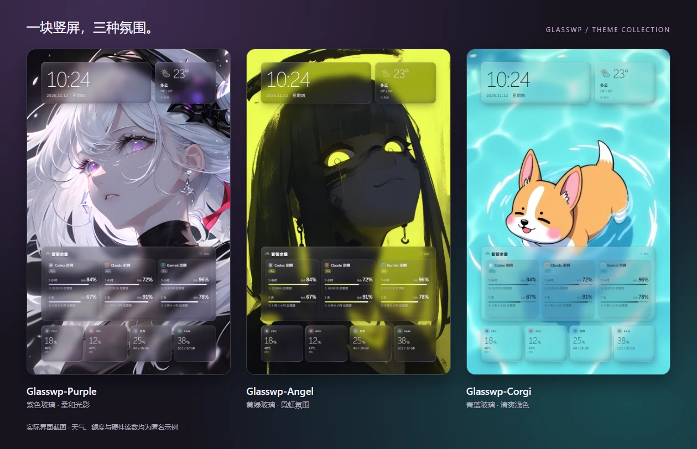
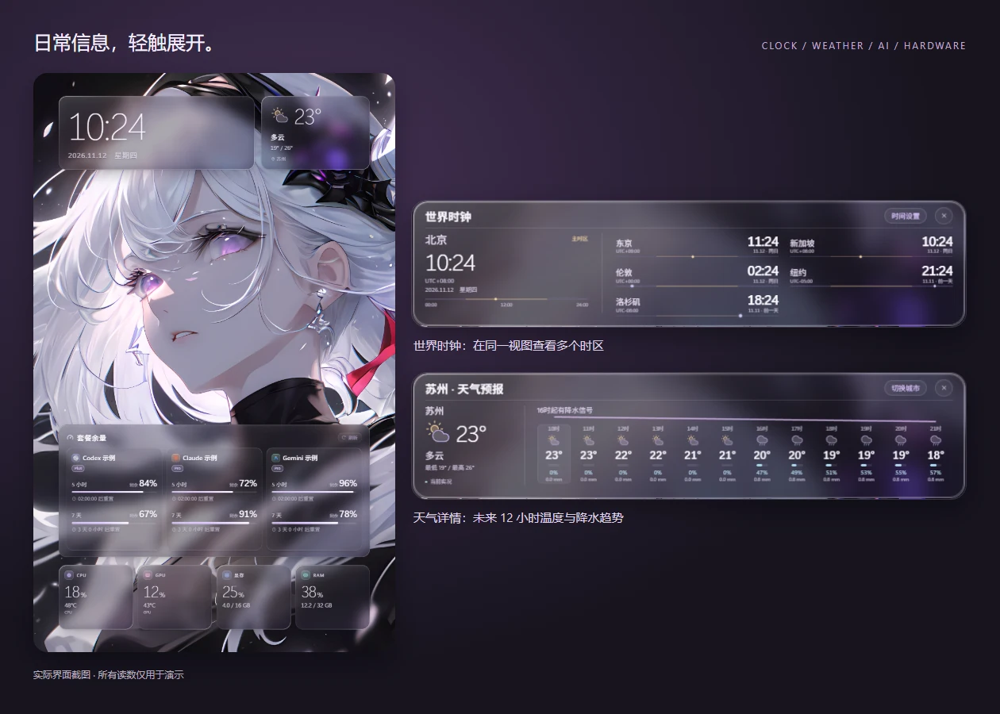
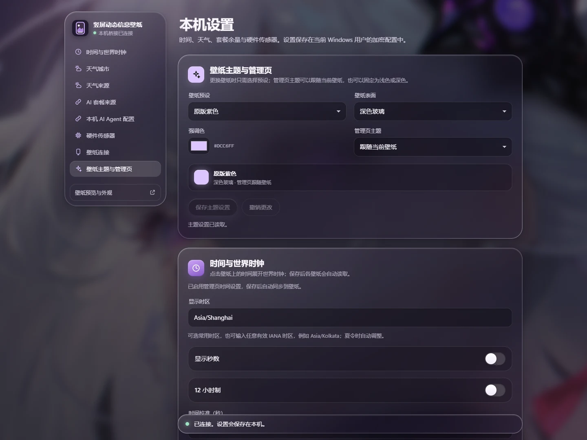

<h1 align="center">Glasswp</h1>

<p align="center">让时钟、天气、AI 余量与硬件状态，融进你的竖屏壁纸。</p>

<p align="center">Windows x64 · Wallpaper Engine · 本机数据桥接</p>

<p align="center">
  <a href="#快速安装">安装桥接</a> · <a href="#快速开始">开始使用</a> · <a href="docs/INSTALL.md">安装指南</a> · <a href="docs/DEVELOPMENT.md">开发文档</a>
</p>

<p align="center">
  
</p>

## 让日常信息留在桌面

Glasswp 是一套面向 Wallpaper Engine 的竖屏 Web 壁纸。玻璃卡片承载常用信息，留出背景画面的主体空间；点击卡片可展开详情，组件的位置、尺寸和材质可以独立调整。

| 功能 | 可以看到什么 |
|---|---|
| 时间与世界时钟 | 日期、12/24 小时制、自选时区，以及展开后的多地时间。 |
| 天气与预报 | 城市天气、温度与可用的小时预报；支持六种天气来源。 |
| AI 套餐余量 | 多账号卡片、余额、额度窗口与重置倒计时；可选择五种数据来源。 |
| 硬件状态 | CPU/GPU 利用率与可用温度、显存、内存，以及最近一分钟趋势。 |
| 可复用主题 | Purple、Angel、Corgi 三套背景；玻璃透明度、模糊、高光、大小与位置均可调。 |

日期与时钟可独立运行。天气、AI 余量和硬件数据需要单独安装 Windows 本机桥接；桥接同时提供设置页，集中管理来源、账号和传感器。

## 快速安装

**运行环境：Windows x64、Wallpaper Engine。** 自包含桥接包运行时无需另装 Node.js 或 .NET。

### 下载正式安装包

从 [GitHub Releases](https://github.com/Gaoshou101/Glasswp/releases/latest) 下载 **`Glasswp-Bridge-v1.0.0-win-x64.zip`**，完整解压，进入同名文件夹，双击 **`install-bridge.cmd`**。

安装器会校验文件，请求一次 UAC，安装并启动桥接、注册登录自启动，随后打开本机设置。默认运行目录为 `E:\WallpaperDashboard`；没有 E 盘时，在解压目录的 PowerShell 中执行：

```powershell
.\install-bridge.cmd -RuntimeRoot 'D:\WallpaperDashboard'
```

正式安装包由 GitHub Actions 构建，附带 `.zip.sha256` 校验文件和构建信息；GitHub 自动提供的 Source code 压缩包是源码。只检查而不安装可追加 `-Check`；不新建或修改自启动任务可追加 `-NoAutostart`。更多选项见 [安装与连接](docs/INSTALL.md)。

### 从源码构建

准备 Node.js 20.19+ 或 22.12+、.NET 10 SDK，在仓库根目录执行：

```powershell
.\scripts\build.ps1
.\scripts\install-bridge.ps1
```

构建生成 `dist` 壁纸、`artifacts/staging` 桥接候选，以及 `artifacts/packages` 下的 ZIP 安装包与 SHA256。构建过程不改变运行中的桥接；第二条命令执行安装。

## 快速开始

1. 打开 [本机设置](http://127.0.0.1:17632/admin/)，选择天气城市和 AI 套餐来源，按需配置账号与传感器。
2. 在 Wallpaper Engine 中打开壁纸包的 `project.json`。桥接安装包也包含通用壁纸，位于 `payload/wallpaper`。
3. 从本机设置页复制“展示票据”，填入 Wallpaper Engine 右侧该壁纸的“展示票据”属性。
4. 在 Wallpaper Engine 属性中调整组件显示、大小、位置和玻璃材质。

源码用户也可用脚本安装 `dist` 并自动配对票据。将下面的路径改为实际 Wallpaper Engine 安装目录：

```powershell
.\scripts\install-wallpaper.ps1 -WallpaperEnginePath 'D:\SteamLibrary\steamapps\common\wallpaper_engine' -PreviewWindow
```

[浏览器预览与外观设置](http://127.0.0.1:17632/?studio) 适合试调效果。Studio 的外观设置只保存在当前浏览器；桌面外观由 Wallpaper Engine 属性保存，两者不会互相同步。天气、账号和传感器属于桥接共享数据。

## 轻触卡片，展开细节

点击时间查看世界时钟，点击天气查看可用的小时预报。额度卡片支持分页与手动刷新；硬件卡片展开后可查看曲线与样本。点击空白处或按 Escape 收起。



本机设置页提供 Light、Dark、跟随壁纸三种模式。各来源的连接、账号别名、排序和刷新选项集中管理，未保存修改会在页面标记。



以上图片来自实际界面，天气、账号、额度和硬件读数使用匿名示例数据。

## 选择数据来源

### AI 套餐

保存后只查询所选来源，各来源的连接和账号配置分别保留。

| 来源 | 适用场景 |
|---|---|
| 本机自动读取 | 从支持的已登录 CLI 或桌面 Agent 获取凭据，读取可用的套餐和余量；各平台支持范围不同。 |
| Magpie | 读取 Magpie 中已保留账号的额度缓存；上游缓存更新由 Magpie 完成。 |
| CPAMP | 读取 CPAMP 账号与额度快照，支持对应的用量刷新和请求历史视图。 |
| CPA | 独立连接 CPA 管理接口，读取支持的配额插件或厂商额度。 |
| Sub2API | 读取支持的上游 OAuth 托管账号余量；不以站内用户余额推算套餐额度。 |

支持范围和连接要求见 [AI 多来源](docs/AI-SOURCES-2026-11-10.md) 与 [CPA / Sub2API](docs/CPA-SUB2API-SOURCES-2026-11-11.md)。独立来源不自动拥有 CPAMP 请求历史功能。

### 天气

Open-Meteo、MET Norway 无需 API Key；OpenWeatherMap、WeatherAPI、高德与和风需配置对应凭据。高德需城市行政区编码，和风需专属 API Host。各来源提供的数据不同，高德不提供小时预报；缺失字段保持未知。

## 配置与使用边界

- 桥接只监听 `127.0.0.1:17632`。管理凭据在本机填写，使用 Windows DPAPI CurrentUser 加密，私有配置默认位于 `%LOCALAPPDATA%\WallpaperDashboard\private`。
- 展示票据用于读取展示数据、报告宿主状态及请求固定刷新；它与管理凭据分开。分享壁纸应使用票据为空的构建包，不要分享私有配置或已配对目录。
- 部分 CPU/GPU 温度需要管理员权限，传感器支持依设备与驱动而异。
- 数据过期或读取失败时保留已有数据并提示状态；倒计时归零显示等待更新，不会推算成满额。天气属于所选服务的数据，不能视作本地传感器实测。
- 三套工坊包固定自己的背景；通用壁纸可跟随桥接主题。修改主题不会迁移凭据。

## 文档导航

| 我想要…… | 文档 |
|---|---|
| 安装、升级、配置自启动或排错 | [安装与连接](docs/INSTALL.md) |
| 开发、测试和生成安装包 | [开发与发布](docs/DEVELOPMENT.md) |
| 更换背景并复用现有组件 | [可复用壁纸工作流](docs/REUSABLE-WALLPAPER-WORKFLOW.md) |
| 打包 Purple / Angel / Corgi 工坊壁纸 | [三套壁纸打包与手动发布](docs/GLASSWP-WORKSHOP.md) |
| 了解天气、时区和显示校准 | [世界时钟与天气](docs/CLOCK-WEATHER-2026-11-10.md) · [高德与和风](docs/AMAP-QWEATHER-2026-11-10.md) |
| 了解数据与权限边界 | [数据契约](docs/DATA-CONTRACT.md) · [运行目录加固](docs/RUNTIME-HARDENING-2026-11-07.md) |
| 查阅实施记录和后续工作 | [实施验证](docs/IMPLEMENTATION-VALIDATION.md) · [优化路线](docs/OPTIMIZATION-ROADMAP.md) |

## 开发

```powershell
npm ci
npm run dev
npm run check
```

前端使用 TypeScript / Vite，Windows 桥接使用 .NET 10。完整构建、浏览器回归和发布验证见 [开发文档](docs/DEVELOPMENT.md)。

## 第三方说明

AI 读取协议和平台图标来源见 [第三方声明](docs/THIRD-PARTY-NOTICES.md) 与 [图标说明](docs/PROVIDER-ICONS.md)。背景图由用户提供，权利归原作者所有；使用、转载或发布前应确认相应授权。
