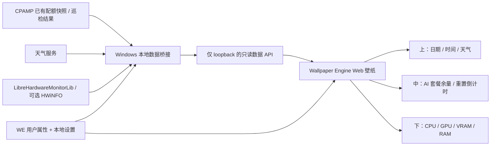

# 竖屏动态信息壁纸：可行性与实施方案

> 2026-10-10 实施更新：用户已取消内存温度；额度新增默认多账号卡片并保留单账号轮播；CPAMP 数据库报错已修复。本文保留最初方案背景，当前状态以 README、实施验证记录和 CPAMP-REPAIR.md 为准。

研究日期：2026-10-10（Asia/Shanghai）。状态：研究建议，尚未开始产品实现。

## 1. 结论

可以实现。推荐使用 **Wallpaper Engine Web 壁纸 + Windows 本地数据桥接程序 + 三个独立组件**。

这条路线适合当前电脑：Wallpaper Engine 已运行，版本文件为 2.8.42。初次检测的竖屏副屏桌面范围为 800×1280；用户随后明确目标显示屏为 **1600×2560**，当前设计以此为基准并自适应其他竖屏。Web 技术适合日期、天气、配额卡片、倒计时和硬件曲线，也能提供轻量动态背景与可配置属性。[Web 官方参考](https://docs.wallpaperengine.io/en/web/overview.html)、[用户属性](https://docs.wallpaperengine.io/en/web/customization/properties.html)

两项功能需要实际联调后确认：

1. 用户部署的 CPAMP 版本能提供哪些账号的配额快照、套餐信息与重置时间，以及这些快照是否持续更新。
2. 本机 CPU/GPU 温度读数和 DDR4 内存条温度传感器的可用性。RAM 使用率可以实现；RAM 温度取决于硬件与驱动，不能保证所有内存条都有读数。

“更新窗口”已由用户明确为 **额度重置周期和倒计时**。

## 2. 已核实环境与证据边界

| 项目 | 实际发现 | 对方案的影响 |
| --- | --- | --- |
| 系统 | Windows 11 专业版，64 位，10.0.26100 | 本地辅助程序采用 Windows 路线 |
| 壁纸宿主 | Wallpaper Engine 正在运行，版本文件 2.8.42 | 优先复用现有宿主 |
| 安装位置 | `F:\SteamLibrary\steamapps\common\wallpaper_engine` | 后续真实宿主联调用此位置 |
| 显示器 | 初次检测：主屏 1920×1080，左侧副屏桌面范围 800×1280；用户提供的目标显示屏为 1600×2560 | 以用户提供的 1600×2560、5:8 比例为设计基准，适配其他竖屏 |
| CPU | Intel Core i5-12600KF | 读取 CPU Total 与 CPU Package 温度 |
| GPU | AMD Radeon RX 6900 XT | 使用 AMD 兼容的传感器路径；排除虚拟显示适配器 |
| 主板 | MSI MPG Z690 EDGE TI WIFI DDR4 | 内存为 DDR4；温度读取需要验证 SMBus/传感器支持 |
| RAM | 4 条 DDR4-3200，8+16+8+16GB，合计 48GB | 使用率与容量明确；温度尚未读取 |
| 显存 | 驱动注册表报告约 16GiB；WMI AdapterRAM 只给出约 4GB | 运行时通过驱动/传感器取总量，不能采用这个 WMI 字段 |
| 其他进程 | 存在 `HWInfoSever.exe` | 进程来源、用途和接口未知，不据名称认定为官方 HWiNFO |
| CPAMP | 从 Hindsight 找到既有地址；只读访问 `/health` 返回 200 与服务标识；`/status` 返回 401 | 服务在线，业务数据需要鉴权；尚未读取真实配额 |

本轮没有安装传感器驱动、修改壁纸配置或改变远端服务。后续方案中的资源目标与工期均为估计，不能当成已测成绩。CPAMP 源码核对的是公开仓库快照，不代表用户部署版本一定具有同样接口。

## 3. 技术路线比较

| 路线 | 对需求的适配 | 成本与限制 | 建议 |
| --- | --- | --- | --- |
| Wallpaper Engine Web + 本地桥接 | 三块实时组件、自定义属性、动态背景、多屏 | 温度和 CPAMP 通过外部桥接；需验证 CEF 与 loopback 通信 | **首选**，本机已经具备宿主 |
| Lively Web + 本地桥接 | 免费开源；已有 CPU/GPU/RAM 基础数据回调 | 官方数据示例未提供完整温度、VRAM 字段；天气接口仍标记未完成；仍需桥接补全 | 无 WE 时的备选 |
| WE 背景 + Rainmeter 组件 | 桌面组件生态成熟，硬件工具对接丰富 | 配置分散在两套软件，布局、交互和生命周期需协调 | 若已有 Rainmeter 工作流可考虑 |
| 自建 WebView2 桌面宿主 | 可自行控制内容、桥接与发布 | 要处理桌面附着、焦点、Explorer 重启、多屏与暂停恢复 | 独立软件产品需求明确后再评估 |

Lively 的官方 `--system-information` 示例展示 CPU、GPU 3D 与 RAM；不能据此承诺已覆盖所有温度与显存需求。[Lively 系统数据](https://github.com/lively-community/lively/wiki/Web-Guide-V-%3A-System-Data)

这里的“插件”定义为壁纸内部可配置、可替换的组件，不依赖 Wallpaper Engine 的通用原生 DLL 插件接口。首版采用受信任的内置模块，后续新模块沿用相同数据和配置契约。

## 4. 系统结构



### 4.1 前端

- TypeScript + Vite 构建；首版可以使用轻量 DOM 组件，复杂设置页再考虑 React。
- CSS 处理排版与短过渡，Canvas/WebGL 处理背景；所有字体与素材本地打包。
- 三个组件独立管理配置、数据和失效状态，避免一个接口失败影响整张壁纸。
- WE 的 `applyUserProperties` 提供外观设置；`applyGeneralProperties`/`setPaused` 接入帧率与暂停。[属性事件](https://docs.wallpaperengine.io/en/web/api/propertylistener.html)
- 首版先用粒子、光影或渐变背景。若加入视频，按 WE Web 官方支持的 WebM/OGG/OGV 路线验证，不能直接套用独立 Video 壁纸的格式支持。

### 4.2 本地数据桥接

建议使用 C# / 当前受支持的 .NET LTS，嵌入 `LibreHardwareMonitorLib`，负责硬件采样、CPAMP 鉴权、天气缓存、规范化数据、失败重试与诊断。发布为可直接运行的程序；传感器需要的驱动与权限单独说明。

数据 API 只监听 `127.0.0.1`，端口配置化并检查冲突。首版可用 HTTP 快照轮询：硬件每 1–2 秒，配额缓存每 60 秒，天气每 15–30 分钟。规模较小时无需首先引入 WebSocket；需要多屏共享与推送时再升级。

**第一阶段必须验证 WE 本地文件页面连接 loopback 的行为**，包括 CORS、Origin、浏览器本地网络限制、重连与休眠恢复。配对票据限制为读取已筛选的状态，不能把 CPAMP 管理密钥当作页面连接凭据；仅监听 localhost 也不能替代访问控制。若需要同源承载，比较本地网页入口与 Application/WebView2 方案后再定稿，不预设 WE 支持未验证的入口。

CPAMP 管理密钥保存在本机用户私有位置，使用 Windows DPAPI 或凭据存储保护；不进入前端代码、`project.json`、Workshop 包、日志或仓库。桥接只暴露展示所需字段，不提供通用请求转发或账号管理操作。

## 5. 上中下布局与自定义

设计已迭代为保留人物面部的磨砂玻璃布局：上方日期/天气，面部区域留白，下方以额度为主并排列四个硬件模块。默认目标为 **1600×2560**，用户选择“额度优先”；预览已检查 12 种竖屏尺寸和显示缩放。具体规则见 `design/GLASS-DESIGN.md`。原先上 22% / 中 43% / 下 35% 的分区仅是早期建议，不作为当前视觉实现的固定比例。安全边距和任务栏/桌面图标避让作为后续配置项。

| 区域 | 默认内容 | 配置项 |
| --- | --- | --- |
| 上方 | 大时钟、日期/星期、城市、天气、气温、最高/最低温 | 12/24 小时、秒显示、时区、城市、字号、对齐 |
| 中部 | 关注账号/套餐、每个额度窗口的余量条、重置时间与倒计时、数据更新时间 | Provider/账号选择、账号别名、显示窗口、排序、可见行数 |
| 下方 | CPU/GPU/VRAM/RAM 四行，利用率、容量、温度及可选趋势 | GPU 选择、传感器映射、采样周期、曲线开关、温度显示方式 |

所有组件支持独立启用、位置/大小、主题色、透明度、信息密度和配置保存。WE 属性负责常用外观调整；本地设置页负责密钥、数据源、账号与传感器绑定。需要拖动时进入明确的编辑模式，日常展示避免误操作。

800×1280 首屏建议固定展示 2–3 个关注账号，单账号可有多个窗口；其余账号可手动翻页或可选慢速轮播。账号数量增加时不能依靠持续缩小字体。数值变化使用等宽数字保持稳定。

动态效果建议：缓慢光影/粒子、日夜色温变化、天气氛围、额度条平滑变化和小型性能趋势。数据变化不持续闪烁；天气效果强度可关闭；温度/低额度提示保持克制。

## 6. 中部 CPAMP：余量与重置窗口

### 6.1 已核对的上游能力

公开 CPAMP 源码存在以下接口和字段：

| 内容 | 依据 | 用途 |
| --- | --- | --- |
| `POST /v0/management/quota-snapshots/query` | quota snapshot controller 的 `handleQuery` | 按账号读取已保存快照；虽为 POST，语义为查询 |
| `remaining_percent` / `used_percent` | snapshot service 的 `Window` | 展示窗口余量或由明确的已用比例换算 |
| `cycle_end_ms` / `duration_seconds` / `window_mode` | 同上 | 重置倒计时、周期与窗口类型 |
| `boundary_accuracy` | 同上 | 区分 exact / derived / estimated / unknown |
| `observed_at_ms` / `stale` / `field_sources` | 同上 | 显示数据新鲜度与字段来源 |
| `plan_type` / `quota_unit` / `used_value` / `limit_value` | 同上 | 套餐名、次数/金额/其他实际单位，字段存在时才展示 |

源码和 CPAMP 文档说明，不同 Provider 的可用证据不同：Codex 可提供短周期/周窗口；Claude 有基础、周和模型范围额度；Antigravity 等依赖专用接口；OpenAI-compatible 服务不存在通用余量协议。[能力矩阵](https://seakee.github.io/CPA-Manager-Plus/docs/en/reference/capability-matrix.html)

因此可以承诺“接入有证据的数据”，不能承诺所有 Provider 都有精确剩余百分比和重置时间。实际列表以用户实例版本、关注账号和返回字段为准。

### 6.2 显示规则

- 每个账号单独显示窗口；不要把不同账号、模型、短周期和周周期的百分比相加或简单求平均。
- 接口给的是 `used_percent` 时，确认其含义后才转换为 `100 - used_percent`，并做 0–100 限幅。
- 缺字段显示 `—` 或“暂不可用”；真实 0% 与未知必须不同。
- 重置时刻来自上游时间戳；每秒在本地计算倒计时，不为倒计时每秒请求服务器。
- 默认以 Asia/Shanghai 格式化，保留绝对时间与相对倒计时；休眠唤醒后重新计算。
- `estimated`/`derived` 必须保留精度标签；滚动窗口不能伪装成统一的瞬时清零时刻。
- 倒计时到零后显示“等待更新”；读取到新快照后才确认额度恢复。
- 旧数据继续显示上次值，并标注“上次更新/数据已过期”，不清零伪装成耗尽。
- 历史 Token 用量和预估成本不能反推出套餐余额。费用如加入，沿用“CPAMP 预估成本”口径。

### 6.3 如何获得持续更新

**读取缓存与主动刷新上游是两种操作。** CPAMP 文档说明，Provider 配额刷新由用户显式触发；打开页面、读取历史、被动加载 Header 不自动轮询上游。[账号文档](https://seakee.github.io/CPA-Manager-Plus/docs/en/manual/accounts.html)

首版优先消费已有快照、请求响应证据与用户已配置的巡检结果。若某账号没有持续更新来源，展示最后更新时间，并提供跳转 CPAMP/手动刷新入口。若用户希望无人值守持续更新，需要另行确定 Provider 查询策略、频率与服务器现有任务；不能因为每分钟读缓存就宣称额度每分钟更新。

如果用户部署版本缺少快照查询接口，再评估该版本巡检结果/现有 API 适配。无需仅为壁纸先升级生产 CPAMP。

## 7. 下方硬件监控

### 7.1 数据源

首选 `LibreHardwareMonitorLib`：官方提供可嵌入 .NET 库，支持 Intel/AMD CPU 与 AMD/NVIDIA/Intel GPU；部分传感器需要管理员权限。[官方仓库与集成说明](https://github.com/LibreHardwareMonitor/LibreHardwareMonitor)

公开 AMD 实现含 GPU Core 负载、GPU Core 温度、Hot Spot、Memory Used/Total 等；DIMM 实现含 DDR4/DDR5 温度读取路径。但具体能否返回有效值仍须在本机验证。

可选使用用户已安装并合法可用的 HWiNFO 共享内存作为补充。非 Pro 64 位版共享内存有 12 小时限制，持续展示需要合适许可或改用另一数据源。[HWiNFO 官方许可](https://www.hwinfo.com/licenses/)

### 7.2 指标口径

| 指标 | 默认口径 | 降级与注意事项 |
| --- | --- | --- |
| CPU 利用率 | 全 CPU 总负载 | 使用率可由系统计数器补充；温度不可用时独立显示缺失 |
| CPU 温度 | CPU Package | 无 Package 时允许选核心最大值，并标注名称 |
| GPU 利用率 | RX 6900 XT 的 GPU Core 负载 | 可选 D3D 最繁忙引擎口径；与任务管理器差异要说明，不能直接相加各引擎 |
| GPU 温度 | GPU Core；Hot Spot 可作为附加项 | 核心与热点不是同一指标 |
| 显存利用率 | 专用显存已用 / 专用显存总量 | 不使用共享系统内存，不使用 WMI 的截断总容量 |
| RAM 利用率 | `(可用物理总量 - 可用物理内存) / 可用物理总量` | 与系统“可用”口径一致；展示已用/总容量 |
| RAM 温度 | 可读取 DIMM 的最大值，可展开各条 | 硬件没传感器/无法访问时显示“未检测到”，不拿主板温度代替 |

传感器映射保存稳定硬件/传感器 ID，不只匹配英文名称；主板与 GPU 不同版本可能命名不同。RAM 温度筛选要排除“Temperature Sensor Resolution”“Thermal Sensor High Limit”等分辨率或阈值字段。

本机有多种虚拟显示适配器，默认绑定真实 AMD GPU。若必须读取底层驱动，权限集中在采样程序；壁纸渲染不需要因传感器而提升权限。温度不可用属于能力缺失，不应影响其他数值。

### 7.3 刷新

硬件默认每 1–2 秒采样，温度可 2 秒；曲线保留最近 60 秒。文本显示实际采样值，视觉条可以短过渡；睡眠期间留空档，不补造采样。关闭组件时停止相应展示与无用采样。

## 8. 上方天气与时钟

日期、时间直接从本机时间计算，时区可配置；秒显示默认可关闭。天气城市首次设置时选择，不凭 IP 或电脑名称猜所在地。

天气 Provider 保持可替换：首版可用 Open-Meteo 快速验证温度、天气代码、最高/最低温与日出日落；其 current 条件基于天气模型，不能包装成实地传感器观测。[Open-Meteo 官方文档](https://open-meteo.com/en/docs)

需要国内城市体验、空气质量或预警时，再比较和风天气等服务并核对认证、调用额度及使用条款。天气失败保留缓存与更新时间；时钟和其他两块继续工作。

## 9. 插件与数据契约

前端组件建议统一声明：`id`、版本、配置 schema、默认布局、订阅的数据主题，以及初始化/更新/暂停/销毁生命周期。

桥接快照建议包含：

```text
schemaVersion
serverTimeMs
weather: status, observedAtMs, location, current, daily
quota.accounts[].windows[]:
  provider, accountAlias, planType, windowId,
  remainingPercent, usedPercent, windowMode,
  resetAtMs, durationSeconds, accuracy, observedAtMs, stale
hardware:
  cpuUsagePercent, cpuPackageC,
  gpuUsagePercent, gpuCoreC, gpuHotspotC,
  vramUsedBytes, vramTotalBytes,
  ramUsedBytes, ramTotalBytes, dimmTemperaturesC
capabilities / status / source / freshness
```

不存在的数值为 null，状态单独记录。模块订阅不同更新周期，保存配置时不保存瞬时采样和敏感响应。

## 10. 性能策略与验收

默认 30 FPS，提供 15/30/60 FPS 与静态背景选项。硬件采样、日期更新、天气查询与配额缓存使用独立周期。

游戏在主屏运行而信息壁纸位于副屏时，允许选择“暂停全部”或“副屏继续低帧率显示”；不默认关闭用户可能用于游戏监控的副屏。休眠/显示器关闭时暂停渲染、减少采样，恢复时请求新状态。

建议首版以 800×1280、轻量背景、30 FPS 测量：

- 记录壁纸与桥接合计 CPU、RAM、VRAM、GPU 引擎、频率/功耗；与宿主加载静态背景的基线比较。
- 可先争取平均 CPU 增量约 1–2 个百分点、RAM 增量约 300MB 内、VRAM 增量约 200MB 内；这些只是优化目标，需按效果与实测调整。
- 观察游戏帧时间与副屏监控可读性，不能仅凭一个 GPU 百分比判定成本。
- 完成一次 24 小时运行、网络断开、CPAMP 401/超时、传感器缺失、宿主重载、屏幕缩放、休眠唤醒验证。
- 所有公开数据与错误日志中无 CPAMP 密钥、OAuth Token 或真实账号隐私。

## 11. 分阶段实施

| 阶段 | 交付 | 通过条件 | 初步工作量 |
| --- | --- | --- | --- |
| 数据与通信验证 | 本机传感器清单、脱敏 CPAMP 字段样本、WE 通信小原型 | 余量/窗口来源明确；温度能力明确；loopback 可连通 | 0.5–1.5 天 |
| 三组件可运行版本 | 800×1280 Web 壁纸、本地桥接、基本设置、一个动态背景 | 三块接真实数据；缺失和过期正确显示 | 2–4 天 |
| 自定义与视觉完善 | 模块大小/位置/开关、账号筛选、主题、曲线、动态强度 | 不同配置与竖屏尺寸下内容可读 | 2–3 天 |
| 稳定性与交付 | 安装/自启、诊断说明、导入说明、24 小时检查 | 重启/休眠/断网可恢复，无持续资源增长 | 1–2 天，含观察时间 |

合计约 **6–10 个工作日**，按单人实现、已有背景素材估计。CPAMP 版本适配、传感器驱动与定制美术可能扩大范围；这些不是交付承诺。

第一步建议优先进行 **真实数据与 WE 通信验证**。它会决定 CPAMP 适配路径、传感器方案和最终展示字段；随后再冻结视觉设计。

## 12. 开始实现前的配置项

研究已经足以选择路线，以下信息可在实现时通过设置或受保护的本机配置补齐：

1. 确认目标就是当前 800×1280 副屏，或指定另一分辨率。
2. 要常驻显示的 Provider/账号以及显示顺序。
3. CPAMP 部署版本、已有采集/巡检状态，以及安全配置鉴权凭据。
4. 天气城市、偏好的背景风格与是否使用已有素材。
5. 游戏时副屏保持监控还是暂停，以及 RAM 温度无读数时保留占位还是隐藏。

完整来源清单与抓取文件校验见 [研究来源](../research/portrait-dashboard/SOURCES.md)。
