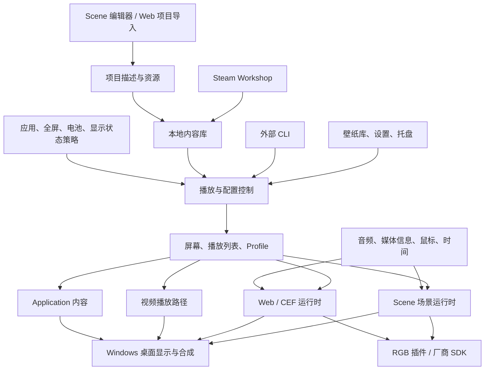

# Wallpaper Engine PC：文档、公开接口与架构研究

研究日期：2026-10-10。用途：为本仓库的桌面壁纸项目提供可追溯的参考，尚未确定本项目技术栈。

## 1. 研究范围与证据边界

本次从两个官方站点的 sitemap 获取全部英文页面：

| 资料 | 页面数 | 内容 |
| --- | ---: | --- |
| [创作者文档](https://docs.wallpaperengine.io/en/) | 192 | Scene 编辑器、效果、粒子、骨骼动画、SceneScript、Shader、Web API |
| [使用与故障排查](https://help.wallpaperengine.io/en/) | 59 | CLI、多屏、应用规则、视频、音频、Steam、启动、兼容性及 Android 附录 |
| 合计 | 251 | 全部成功获取正文，无失败页面 |

额外查阅[产品官网](https://www.wallpaperengine.io/en)，并下载官方 [lib.sceneScript.d.ts](https://docs.wallpaperengine.io/reference/lib.sceneScript.d.ts)。该定义文件头部标记 VERSION 2.8；这不是对用户安装版本或最新发行版本的判断。

**阅读方式**：目录、接口签名和功能主题全面梳理；架构相关的核心接口、行为与约束重点阅读；效果、教程及故障排查逐类查阅概述和关键限制。251 页的完整正文已缓存，但“全量抓取”不代表每一个教程段落、演示视频和截图都已逐项精读。视频未播放，PC 软件未安装运行，所有接口示例均属于文档研究，尚未经过真实软件验证。

本文使用三种证据等级：

- **官方事实**：公开文档直接说明，可通过链接核对。
- **架构归纳**：由公开功能和接口推导出的职责划分，不是官方源码架构图。
- **项目建议**：针对我们新项目的可选设计，不是 Wallpaper Engine 的已知实现，也不是已批准的架构决策。

原始页面索引、抓取时间与 SHA-256 在 `research/wallpaper-engine/sources.json`；分类索引见同目录的 `SOURCES.md`。原文和官方类型定义保留在本地 `raw/`，已加入 Git 忽略。

## 2. 核心认识：这是一套内容运行平台

Wallpaper Engine 将内容制作、内容管理、动态播放、桌面集成和分发整合在一起。Scene 内容包含实时运行、随机性和交互，并不天然具有视频那样固定的起点和终点。官方因此不提供把任意 Scene 直接导出为视频/GIF 的通用功能，而建议录制运行结果。[依据](https://help.wallpaperengine.io/en/functionality/export.html)

### 2.1 四种内容类型

| 类型 | 内容形态 | 已确认的运行能力 | 对我们项目的意义 |
| --- | --- | --- | --- |
| Scene | 场景、图层、材质、纹理、脚本等；发布内容可打包为 `.pkg` | 2D/3D、粒子、效果、时间轴、骨骼、音频响应、交互 | 需要真正的场景运行时和资源管线 |
| Web | HTML/CSS/JavaScript 和本地资源 | CEF 浏览器、页面交互、宿主桥接、WebGL 等 Web 能力 | 可利用现成浏览器运行时，但必须处理桌面和资源管理 |
| Video | 视频文件 | 视频解码与播放；支持硬件加速 | 可作为较早实现的动态内容类型 |
| Application | 编译后的应用程序 | 应用型壁纸；其自身源码通常不可获得 | 属于独立执行内容，不能直接套用 Web/Scene API |

依据：[下载壁纸的类型与文件](https://help.wallpaperengine.io/en/functionality/editingwallpapers.html)、[Web 总览](https://docs.wallpaperengine.io/en/web/overview.html)、[3D 模型](https://docs.wallpaperengine.io/en/scene/models/introduction.html)。

Scene 的 2D 和 3D 是场景模式区别：2D 默认偏向平面投影，但也能放 3D 模型；不能把“Scene”简单等同于“3D”。静态图片通常是 Scene 的素材入口，不能据此额外推定一套官方独立 Image API。

### 2.2 功能架构图

以下是**架构归纳**，表示职责和数据流，不表示真实 IPC 协议或一一对应的进程。



## 3. 公开实现线索与未公开部分

### 3.1 文档能够确认的事实

- Web 使用 **Chromium Embedded Framework（CEF）**，可通过 CEF DevTools 端口连接 Chrome 调试。[依据](https://docs.wallpaperengine.io/en/web/debug/debug.html)
- 帮助文档列出 `wallpaper32.exe`、`wallpaper64.exe`、`webwallpaper32.exe`、`wallpaperui.exe`、`launcher.exe` 等程序名，说明存在不同用途的可执行组件。[依据](https://help.wallpaperengine.io/en/noshow/nowallpaper.html)
- 位数文档说明 64 位选择主要用于 Scene/Video；其所描述的 Web 与 UI 路径仍使用 32 位程序。此条是当前网页描述，后续须核对实际发行包。[依据](https://help.wallpaperengine.io/en/general/bits.html)
- 官方说明核心是自行编写的软件方案，紧密依赖操作系统；没有当前立即支持 macOS/Linux 的计划。[依据](https://help.wallpaperengine.io/en/functionality/linuxmacos.html)
- Shader 文档确认 Windows 的 DirectX 11/HLSL 路径和移动端 OpenGL ES/GLSL 路径，以及自定义的转换和预处理机制。[依据](https://docs.wallpaperengine.io/en/scene/shader/mobile.html)
- 视频故障排查涉及 Media Foundation、DirectShow 和可选 LAV，视频默认使用 GPU 解码以降低 CPU 开销。[依据](https://help.wallpaperengine.io/en/videos/performance.html)、[LAV](https://help.wallpaperengine.io/en/videos/lav.html)

### 3.2 文档不能确认的内容

这些公开文档不是 Wallpaper Engine 的内部设计说明或可嵌入引擎 SDK。它们没有完整给出：

- 内部模块源码、线程模型、IPC 帧格式和进程创建策略；
- 真实渲染图、GPU 资源调度与跨进程共享细节；
- 将窗口置于桌面图标后方的具体 Win32 调用与恢复算法；
- `.pkg` 的完整官方公开格式、跨版本解析契约；
- 通用第三方原生插件 ABI，或一套公开的通用 REST/WebSocket 桌面控制服务。

因此不能把常见的 Progman/WorkerW 技术写成已验证的 Wallpaper Engine 内部实现，也不能把 `window.wallpaperPluginListener` 解读成“支持任意 DLL 插件的公开 SDK”。如需实现桌面宿主，应单独研究 Windows 接口并制作原型验证。

## 4. 外部控制接口：CLI

**官方事实**：先运行 Wallpaper Engine，再通过 `wallpaper32.exe` 或 `wallpaper64.exe` 发出 `-control` 命令。[完整参考](https://help.wallpaperengine.io/en/functionality/cli.html)

| 命令 | 作用 | 主要参数 / 注意事项 |
| --- | --- | --- |
| `pause` / `stop` / `play` | 暂停、停止、恢复全部壁纸 | 暂停与停止语义应分开 |
| `mute` / `unmute` | 全局静音切换 | 与播放状态不是同一个维度 |
| `openWallpaper` | 加载壁纸 | `-file`、`-location` 或 `-monitor`、`-preset`；可窗口播放 |
| `closeWallpaper` | 关闭指定或全部壁纸 | 可指定屏幕或窗口的 location |
| `nextWallpaper` | 切换到下一壁纸 | 可指定屏幕 |
| `openPlaylist` | 加载已有播放列表 | `-playlist` 与可选屏幕参数 |
| `openProfile` | 应用已有多屏配置 | `-profile` |
| `applyProperties` | 运行中修改壁纸设置 | JSON 使用 `RAW~(...)~END` 分隔 |
| `hideIcons` / `showIcons` | 桌面图标显隐 | 独立功能 |
| `getWallpaper` | 查询当前壁纸路径 | 输出到标准输出；可指定屏幕 |

`-monitor` 从 **0** 开始；`-location` 是内部显示器标识，可在 `config.json` 中查找。屏幕索引与稳定标识不是同一概念。

窗口播放的参数包括 `-playInWindow`、`-width`、`-height`、`-x`、`-y`；正文还说明 `activate`、`borderless`。唯一窗口名用于区分多个窗口。

文档示例改写为 PowerShell 的形式如下，路径是占位示例，不会在本次研究中执行：

```powershell
& 'C:\Example\wallpaper_engine\wallpaper64.exe' -control pause
& 'C:\Example\wallpaper_engine\wallpaper64.exe' -control openWallpaper -file 'C:\Example\project.json' -monitor 0
& 'C:\Example\wallpaper_engine\wallpaper64.exe' -control applyProperties -properties 'RAW~({"rate":10})~END' -monitor 0
& 'C:\Example\wallpaper_engine\wallpaper64.exe' -control getWallpaper -monitor 0
```

CLI 是调用 Wallpaper Engine 的外部入口，不是可以复制到自有引擎中的渲染实现。公开文档也未定义每条命令的统一错误码、超时、事务与事件订阅协议，集成时需真实验证。

## 5. Web 壁纸的宿主桥接

### 5.1 项目导入与配置

Web 内容放在独立目录，以主 HTML 文件导入；相关文件会复制到 `wallpaper_engine/projects/myprojects/`。引擎生成 `project.json`，其中包含项目和用户属性配置。导入会递归读取子目录，混入大量无关文件可能卡住导入。[依据](https://docs.wallpaperengine.io/en/web/first/gettingstarted.html)

官方建议把重要的 HTML/CSS/JS、框架和图片随项目打包，保证离线运行；布局应适配不同分辨率、竖屏和超宽比例。

### 5.2 属性事件

[公开接口](https://docs.wallpaperengine.io/en/web/api/propertylistener.html)：

```javascript
window.wallpaperPropertyListener = {
  applyUserProperties(properties) {},
  applyGeneralProperties(properties) {},
  setPaused(isPaused) {},
  userDirectoryFilesAddedOrChanged(propertyName, changedFiles) {},
  userDirectoryFilesRemoved(propertyName, removedFiles) {}
};
```

- 属性监听器应尽早在全局初始化，避免错过首次加载事件。
- `applyUserProperties` 在首次加载及用户修改时调用；修改后只包含有变化的字段。
- Web 用户属性通常是 `properties.key.value`，颜色是空格分隔的归一化 RGB 字符串，例如 `"1 0 0"`。
- `applyGeneralProperties` 可读取 `fps`；页面需要据此限制自己的渲染更新。
- `setPaused` 是通知；文档说明引擎还会冻结渲染进程，不能仅用页面回调替代宿主暂停管理。
- 检查字段是否存在时，应判断属性对象或键的存在，避免把 `false`、`0`、空字符串误判成未提供。

### 5.3 可配置属性与用户文件

[属性参考](https://docs.wallpaperengine.io/en/web/customization/properties.html)支持颜色、滑块、勾选、选项、文本、文件与目录；还支持[条件显示](https://docs.wallpaperengine.io/en/web/customization/displaycondition.html)及[属性本地化](https://docs.wallpaperengine.io/en/web/customization/localization.html)。

目录有两种模式：

| 模式 | 契约 | 适合用途 |
| --- | --- | --- |
| `ondemand` | `wallpaperRequestRandomFileForProperty(propertyName, callback)` | 按需随机取图、幻灯片 |
| `fetchall` | 文件新增/变化和删除事件 | 需要维护用户文件列表的内容 |

文档中的本地文件路径由页面加 `file:///` 加载。`fetchall` 也不是“立即解码目录中所有图片”的指令，需要控制实际载入规模。

### 5.4 音频频谱

[完整参考](https://docs.wallpaperengine.io/en/web/audio/visualizer.html)：

```javascript
window.wallpaperRegisterAudioListener(function (audioArray) {
  // 左声道：0..63；右声道：64..127
});
```

| 项 | 文档契约 |
| --- | --- |
| 数组长度 | 固定 128 |
| 频段 | 每声道 64 个，由低频到高频 |
| 发送频率 | 大约每秒 30 次，不等于页面 FPS |
| 数值 | 通常 0..1，但可能超过 1；可视化应做限幅 |
| 注册时机 | 一次、尽早注册，不放入 `window.onload` 等延迟事件 |
| 能力声明 | `project.json` 的 `supportsaudioprocessing: true`；编辑器可自动检测 |

频谱数据已经过处理，不能当成 PCM 原始音频缓冲。官方帮助说明其音频分析不能直接限定到某个音乐播放器，文档给出的办法是虚拟音频设备。[依据](https://help.wallpaperengine.io/en/audio/limittomusicplayer.html)

### 5.5 媒体会话

[媒体接口](https://docs.wallpaperengine.io/en/web/audio/media.html)读取通过 Windows 全局媒体会话暴露的播放信息：

- `wallpaperRegisterMediaStatusListener`：是否启用媒体集成；
- `wallpaperRegisterMediaPropertiesListener`：标题、艺术家、专辑、内容类型等；
- `wallpaperRegisterMediaThumbnailListener`：封面及主题色、对比色；
- `wallpaperRegisterMediaPlaybackListener`：播放、暂停、停止；
- `wallpaperRegisterMediaTimelineListener`：位置与时长，单位为秒。

播放器不一定提供全部字段；进度事件也可能从未触发。文档中的 Web 封面为 Base64 PNG 字符串，可用于图片 `src`。媒体事件按数据变化触发，不是固定帧率更新。

音频分析和媒体元数据是两条独立能力：能看到歌名不代表能拿到音频频谱，反之亦然。

### 5.6 RGB 插件

[RGB 参考](https://docs.wallpaperengine.io/en/web/api/rgb.html)：

```javascript
window.wallpaperPluginListener = {
  onPluginLoaded(name, version) {}
};
// 仅在 led 插件确认已加载后调用：
// window.wpPlugins.led.setAllDevicesByImageData(encodedImageData, width, height);
```

Canvas RGBA 要转为连续 RGB 字节字符串；官方建议小尺寸采样，例如 100×20，以降低成本。`led` 为通用灯光路径，`cue` 提供 Corsair 专用能力；[iCUE 扩展](https://docs.wallpaperengine.io/en/web/api/icue.html)含协议、设备、灯位和颜色控制。

这是一组特定插件暴露的桥接接口；没有证据可据此推断通用第三方插件 ABI。

### 5.7 FPS 与调试

- 动态内容读取全局 FPS，优先采用 `requestAnimationFrame` 与时间累计实现更新限速。[参考](https://docs.wallpaperengine.io/en/web/performance/fps.html)
- 代码限速不保证 CSS 动画、视频和所有 GPU 工作都同步受限；这些需在选定浏览器引擎上验证。
- CEF DevTools 在配置的本地端口提供调试目标，重载后目标可能改变。[参考](https://docs.wallpaperengine.io/en/web/debug/debug.html)
- 官方文档所述 Web 视频仅支持 `.webm`、`.ogg`、`.ogv`。不能把独立 Video 壁纸或 Scene 的 MP4 纹理支持直接套到 Web。[参考](https://docs.wallpaperengine.io/en/web/overview.html)

## 6. Scene 编辑器和资源运行体系

### 6.1 图层与属性绑定

Scene 的基本构件包含图片、文字、声音、粒子、3D 模型、灯光、相机和辅助图层。图层具有位置、旋转、缩放、可见性、层序和父子关系。[资源](https://docs.wallpaperengine.io/en/scene/assets/overview.html)

效果可以附着于图像、文字、全屏和组合图层，并可引用其他图层作为输入。效果顺序会影响最终输出，例如 Motion Blur 只处理它前面的效果。[效果](https://docs.wallpaperengine.io/en/scene/effects/introduction.html)、[顺序例子](https://docs.wallpaperengine.io/en/scene/effects/effect/motionblur.html)

同一属性体系可连接手动值、用户属性、时间轴和 SceneScript；Shader 参数也可以通过该体系变得可配置。这是编辑器与运行时共用数据模型的关键设计线索。

### 6.2 效果体系

效果目录覆盖图像混合、色彩、模糊、变形、鼠标交互、水、云、火、光线、噪声和流体。主要复用纹理、Opacity Mask、Flow Map、时间偏移、Shader 参数与多个渲染步骤。较高成本的效果包括复杂模糊、God Rays、HDR Bloom、流体等。[目录](https://docs.wallpaperengine.io/en/scene/effects/overview.html)

“同样视觉”可能来自不同实现：例如静态调色适合离线处理，实时调色才需要运行效果；已有火焰的变形与新生成火粒子是两种不同能力。新项目应按效果机制组织模块，避免逐个名称堆实现。

### 6.3 粒子体系

公开粒子配置分为：

1. General：材质、纹理、最大数量、系统空间等；
2. Emitters：球、盒、图层图像等发射方式；
3. Initializers：寿命、尺寸、颜色、速度、初始位置等；
4. Operators：移动、重力、衰减、振荡、力场、碰撞等随时间行为；
5. Renderers：Sprite、Trail、Rope 等；
6. Control Points：8 个控制点，0 绑定系统原点；
7. Children：静态、跟随、出生、死亡等事件生成子系统。

需要发射器和渲染器；某些初始化器依赖相应 Operator 才能产生行为。子系统数量与 Max Count 直接影响内存占用。[粒子总览](https://docs.wallpaperengine.io/en/scene/particles/introduction.html)

### 6.4 时间轴、骨骼与模型

- 时间轴提供 Loop、Mirror、Single、关键帧、曲线、组合属性动画以及动画事件。[时间轴](https://docs.wallpaperengine.io/en/scene/timeline/introduction.html)
- Puppet Warp 由独立图片或角色图集生成几何、骨架和权重；可扩展到骨骼约束、物理、IK、Blend Shapes、附着点、纹理通道和交互。[Puppet Warp](https://docs.wallpaperengine.io/en/scene/puppet-warp/introduction.html)
- 官方交互教程说明每帧先处理动画、后处理脚本，使脚本能覆盖骨骼动画结果；不要把此条无限扩展为所有内部阶段的完整调度顺序。[依据](https://docs.wallpaperengine.io/en/scene/puppet-warp/interactive.html)
- 3D 可导入带动画的 FBX，以及较简单的 OBJ；支持材质、模型动画、相机、灯光、阴影和体积光。[模型](https://docs.wallpaperengine.io/en/scene/models/introduction.html)
- 2D 层也可利用法线图获得实时光照和反射。[照明](https://docs.wallpaperengine.io/en/scene/lighting/introduction.html)

### 6.5 前景与深度处理

编辑器提供前景分离、外部图片编辑器入口、角色图集、相机视差、深度视差等。自动深度图生成使用可选的免费 Editor Extensions DLC，其较大的神经网络属于创作工具依赖，使用壁纸的人不需要安装该 DLC。[深度视差](https://docs.wallpaperengine.io/en/scene/parallax/depthparallax.html)

这给我们的启示是：资源预处理可与运行时分离；不应默认让所有用户承担创作工具的模型体积。

## 7. SceneScript：按属性绑定的脚本系统

[语言参考](https://docs.wallpaperengine.io/en/scene/scenescript/reference.html)说明遵循 ECMAScript 2018；它与 JavaScript 核心语义相近，但没有浏览器 DOM 等 Web 功能。不能直接移植依赖 `window`、`document` 的页面代码。

### 7.1 全局对象

| 对象 | 职责 |
| --- | --- |
| `engine` | 分辨率、画布、时间、帧时间、用户属性、资源注册、音频、设备环境 |
| `thisScene` | 图层访问、创建/销毁、排序、相机、全局场景属性、动态模型数据 |
| `thisLayer` | 当前图层属性、动画、父子关系、骨骼等 |
| `thisObject` | 当前绑定属性所属对象；类型取决于绑定位置 |
| `input` | 鼠标位置与按键状态 |
| `shared` | 多个脚本共享的内存对象 |
| `localStorage` | 壁纸持久数据，按屏幕或全局存储 |
| `console` | 日志与错误 |

脚本附着于具体属性，`init(value)` 和 `update(value)` 可返回新值。通用逻辑可附着 Visibility 等属性；复杂逻辑也可在一个脚本里直接更新多个属性以减少重复计算。不要误解为每个图层只能存在一个脚本。

### 7.2 生命周期和事件

主要事件：`init`、`update`、`destroy`、`resizeScreen`、`applyUserProperties`、`applyGeneralSettings`、六类 cursor 事件，以及媒体集成事件。时间轴教程还提供 `animationEvent(event, value)`。[事件例子](https://docs.wallpaperengine.io/en/scene/timeline/animationevents.html)

约束：

- `update` 每帧调用，尽量把可由事件触发的工作放在对应事件中；
- 动画速度使用 `engine.frametime` 归一化；
- `resizeScreen` 不应当作首次加载通知，初始化布局也要从 `init` 调用；
- 属性变更是增量，SceneScript 通常直接读 `changedUserProperties.key`，不同于 Web 的 `.key.value`；
- cursor 事件要求对象标记为 Solid；公开 CursorEvent 对 2D 支持更完整；
- `shared` 是共享内存对象，不是持久化存储；
- Local Storage 每壁纸最多 100 KB，默认按屏幕，重置壁纸设置会清理。[存储](https://docs.wallpaperengine.io/en/scene/scenescript/reference/class/ILocalStorage.html)

### 7.3 音频、资源与动态几何

`engine.registerAudioBuffers(resolution)` 支持 16/32/64 个频段，返回 `left`、`right`、`average` Float32Array，内容随帧更新；与 Web 的固定 128 数组契约不同。[IEngine](https://docs.wallpaperengine.io/en/scene/scenescript/reference/class/IEngine.html)、[AudioBuffers](https://docs.wallpaperengine.io/en/scene/scenescript/reference/class/AudioBuffers.html)

动态资源由 `engine.registerAsset(...)` 注册，再供 `thisScene.createLayer(...)` 等使用。注册也是发布时发现依赖的依据；否则静态场景没有引用的资源可能漏打包。官方要求资产路径使用硬编码字符串，尤其涉及 Android 导出。[IEngine](https://docs.wallpaperengine.io/en/scene/scenescript/reference/class/IEngine.html)

动态模型由 `createModelData` 创建，`applyData` 适合更新同结构缓冲，`replaceData` 用于结构变化，后者不适合每帧调用。顶点布局、索引、CCW 三角形和材质均需正确声明。[IModelData](https://docs.wallpaperengine.io/en/scene/scenescript/reference/class/IModelData.html)、[教程](https://docs.wallpaperengine.io/en/scene/scenescript/tutorial/models.html)

### 7.4 用户快捷方式的边界

`engine.openUserShortcut` 触发用户自己配置的文件、目录、网页或命令快捷方式，只允许在相应点击/按下/释放事件里按规定调用；每次用户点击只能调用一次。快捷方式绑定具体机器，不随跨机器预设共享。[快捷方式](https://docs.wallpaperengine.io/en/scene/userproperties/usershortcut.html)

这是用户配置能力，不意味着任意 SceneScript 都拥有无条件系统命令执行权限。

## 8. Shader 与材质契约

官方采用近似 GLSL 的语法，并按平台转换为 HLSL/GLSL。自定义预处理器不是完整 C 预处理器，例如不支持 `#elif`。[总览](https://docs.wallpaperengine.io/en/scene/shader/overview.html)、[语法](https://docs.wallpaperengine.io/en/scene/shader/syntax.html)

关键机制：

- `attribute`、`varying`、`uniform` 与输出变量；
- 纹理采样与跨平台别名，如 `texSample2D`、`mix`、`CAST3`；
- 引擎常量：时间、鼠标、屏幕、矩阵、纹理尺寸和音频频谱等；
- Uniform 后面的 JSON 注释声明编辑器显示、默认值、范围、颜色或纹理设置；
- Combo 声明控制编译变体，适用于可裁掉的昂贵逻辑；
- 参数前缀 `u_` 避免与引擎未来增加的常量冲突。

官方支持效果 Shader 的兼容性；擅自覆盖系统 Shader 不获得同等兼容保证。[变量](https://docs.wallpaperengine.io/en/scene/shader/variables.html)

**项目建议**：如果未来开发 Scene 编辑器，应先设计“参数元数据 → 编辑器控件 → 用户设置 → 渲染参数”的统一契约，再选择 Shader 语法与图形后端。本文不建议立即复刻 Wallpaper Engine 的预处理器或格式。

## 9. 项目文件、发布与本地内容库

`project.json` 是项目描述入口，可见字段包括 `title`、`description`、`type`、`file`、`preview`、`tags`、`visibility`、`workshopid`，以及 `general.properties`。这些是文档中的示例字段，不能当作完整、正式的 JSON Schema。[项目例子](https://help.wallpaperengine.io/en/functionality/editingwallpapers.html)

Scene 编辑源常见入口为 `scene.json`，发布后可以是 `.pkg`。官方明确 `.pkg` 不保留全部编辑器项目数据，不能直接当作完整可编辑源项目打开。[依据](https://help.wallpaperengine.io/en/functionality/editingwallpapers.html)

常见目录职责：

| 相对目录 | 用途 |
| --- | --- |
| `wallpaper_engine/projects/myprojects/` | 用户创作项目源文件 |
| `wallpaper_engine/projects/defaultprojects/` | 内置项目 |
| `Steam/steamapps/workshop/content/431960/` | Steam 管理的 Workshop 内容 |
| `wallpaper_engine/projects/backup/` | 官方指导的本地备份内容 |

安装位置可能不同，应通过实际安装位置解析，不能写死用户机器上的路径。

Steam 负责 Workshop 下载；Wallpaper Engine 显示其下载状态。核心播放能力不要求 Steam 常驻；下载、发布和更新依赖 Steam。[官网](https://www.wallpaperengine.io/en)、[下载](https://help.wallpaperengine.io/en/steam/download.html)

发布不是源项目备份；组件、效果和脚本也可以单独分享。动态资源依赖需要显式登记。Workshop 内容被删除时，Steam 也可能删除本机订阅内容，本地备份应有独立生命周期。[发布](https://docs.wallpaperengine.io/en/scene/first/publishing.html)、[资源分享](https://docs.wallpaperengine.io/en/scene/assets/sharing.html)、[备份](https://help.wallpaperengine.io/en/steam/backup.html)

**项目建议**：我们应分别管理源项目、运行包、用户设置和内容来源标识，并设计自己的带版本 Manifest。直接支持 WE `.pkg` 和接入 WE 的 Workshop 均不能仅凭这些文档承诺。

## 10. 多屏、播放列表与规则调度

### 10.1 显示对象

官方支持多屏、宽屏、竖屏和跨屏；跨屏对齐依据屏幕像素布局，而不是显示器真实物理尺寸。[依据](https://help.wallpaperengine.io/en/general/multiscreencenter.html)

Profile 是所有屏幕的壁纸与播放列表配置快照，保存之后的后续改动不会自动更新 Profile。[依据](https://help.wallpaperengine.io/en/functionality/wallpaperperapp.html)

应用规则中的 Load wallpaper/Load playlist 会加载一个内容并跨屏；每屏独立壁纸或列表应使用 Load profile。这是特定规则功能的行为，不应误解为整个软件只支持一个播放列表。

### 10.2 运行策略

从官网和帮助文档可确认：全屏/最大化应用、应用运行、应用播放音频、电池供电、显示器睡眠等情况可以影响播放；播放列表可按间隔、时间、登录或应用条件切换。[官网](https://www.wallpaperengine.io/en)、[应用规则](https://help.wallpaperengine.io/en/functionality/applicationrules.html)

暂停是保留内容的暂停；Stop (free memory) 是释放占用。静音是独立音频状态。这三者不能混为一个 `isPlaying` 布尔值。[性能规则](https://help.wallpaperengine.io/en/performance/game.html)

**项目建议**：运行状态至少区分 loading、running、paused、stopped、failed；音频状态独立。具体状态名、优先级和恢复机制属于我们自己的协议，需要后续定稿。

## 11. Windows 集成与性能的实际风险

| 主题 | 文档证据 | 我们项目需验证的行为 |
| --- | --- | --- |
| 桌面合成 | 视频也要与桌面图标合成，动态内容和普通播放器不同 | 图标、桌面点击、窗口层级、焦点、Explorer 重启恢复 |
| 混合 GPU | 跨 GPU 复制可能让 DWM/CPU 成本上升 | GPU 选择、跨屏、集显/独显及混合显卡 |
| 多屏刷新率 | 不同刷新率曾导致系统问题 | 独立帧调度、屏幕热插拔和不同 DPI |
| Web 焦点 | 新 Web 壁纸可能抢焦点，尤其游戏中列表切换 | 后台创建/切换不得激活窗口 |
| 显示器睡眠 | 文档建议可用 Stop 释放内存 | 停止输出、睡眠唤醒、资源重建 |
| 系统睡眠 | 活跃音频或浏览器行为可能阻止睡眠 | 不应不必要地持有电源请求或音频流 |
| 视频解码 | 依赖 GPU/系统媒体组件，Windows N 可缺媒体功能 | 硬件解码可用性、失败提示、降级路径 |
| 桌面冲突 | Windows 幻灯片或其他桌面软件可影响显示 | 可诊断冲突、退出后恢复桌面 |
| 启动 | 普通启动与服务优先启动不同，优先启动不提升渲染性能 | 先实现普通用户启动；服务需要单独评估 |

依据：[DWM](https://help.wallpaperengine.io/en/performance/dwm.html)、[刷新率](https://help.wallpaperengine.io/en/performance/refresh.html)、[焦点](https://help.wallpaperengine.io/en/general/focusloss.html)、[睡眠](https://help.wallpaperengine.io/en/general/brokensleep.html)、[Windows N](https://help.wallpaperengine.io/en/videos/windows-n.html)、[启动](https://help.wallpaperengine.io/en/functionality/automaticstartup.html)。

纹理和运行资源方面：

- 文件压缩大小不等于 GPU 内存占用，应按实际纹理格式和尺寸估算；
- 裁剪透明区域、控制纹理分辨率、压缩、避免多余图层和昂贵效果是主要优化路径；
- 文档推荐约 300 MB VRAM 或更少，500 MB 以下仍可接受，属于作者指导，不是本项目自动继承的预算；
- 视频帧率是源视频属性，Scene/Web 的 FPS 设置不能直接改变其解码负担；
- 性能验收应同时观察 CPU、内存、VRAM、帧时间、GPU 频率/功耗及解码引擎，不能只看一个 GPU 百分比。

依据：[纹理优化](https://docs.wallpaperengine.io/en/scene/performance/texture.html)、[GPU 指标](https://help.wallpaperengine.io/en/performance/gpu.html)。官方 GPU 帮助页的频率比例计算是简化解释，不能作为精确的通用功耗或 GPU 成本算法。

动态 Windows 锁屏不是已支持能力；官方仅允许用当前动态壁纸快照替换静态锁屏图，屏保是另一种 Windows 集成。[依据](https://help.wallpaperengine.io/en/general/lockscreen.html)、[屏保](https://help.wallpaperengine.io/en/functionality/screensaver.html)

## 12. 文档版本差异和接口陷阱

阅读发现官方资料也存在更新不同步或表述差异，后续开发应核对目标发行版本：

1. 帮助站仍含 Windows 7 教程，但[版本兼容页](https://help.wallpaperengine.io/en/general/deprecated.html)说明从 2.5 起结束 Windows 7/8 支持，旧系统需 2.4 兼容分支。
2. Web 媒体页的状态监听示例定义了 `wallpaperMediaStatusListener`，注册处却使用 `wallpaperAudioListener` 名称；复制时必须改为实际媒体回调。
3. 同一 Web 媒体页同时出现 `wallpaperMediaIntegration.playback.PLAYING` 和 `PLAYBACK_PLAYING` 等常量写法；目标版本运行时需核对，不能在文档研究中假装已实测确定。
4. SceneScript 颜色教程有 0..255 表述，属性/媒体和 WEColor 参考强调归一化值；使用具体 API 前核对它的颜色范围，不能跨 API 统一假定。
5. `registerAsset` 网页签名写单参数，官方 `.d.ts` 含 `precache` 参数；定义文件可辅助编辑器，但不是替代真实运行验证的严格契约。
6. `IScene` 页面出现 `IModelData.update()` 引用，而实际 IModelData 参考和类型定义公开的是 `applyData` / `replaceData`。
7. 时间轴教程公开 `animationEvent`，本次类型文件的 `IComponent` 没有列出它；类型文件不是所有教程回调的无遗漏清单。

这些差异已记录为后续验证项，不能擅自写成已修复的软件缺陷。

## 13. 对我们项目的可选架构建议

以下建议用于后续讨论，尚未作为项目决策保存。

### 13.1 建议先明确的模块边界

| 模块 | 主要职责 |
| --- | --- |
| Desktop Host | 桌面附着、输入/焦点、窗口与 Explorer 生命周期 |
| Display Manager | 稳定屏幕标识、拓扑、DPI、逐屏/跨屏布局 |
| Runtime Manager | 内容加载、暂停、停止、崩溃处理、切换与资源释放 |
| Renderer Adapters | Image/Video/Web/未来 Scene 的独立实现与能力声明 |
| Content Library | 导入、校验、Manifest、缩略图、缓存、来源、升级 |
| Property System | Schema、默认值、增量更新、逐屏值、条件显示、本地化 |
| Policy Scheduler | 应用规则、全屏、电池、睡眠、列表与配置切换 |
| System Providers | 音频频谱、媒体信息、鼠标、时间、可选 RGB |
| App UI / CLI | 通过统一命令入口管理内容与设置 |
| Diagnostics | 日志、失败原因、帧时间、资源统计与导出 |

可把 UI 与长期运行的内容播放器分离，选定框架后明确进程边界、IPC、能力权限与故障恢复。这个建议不意味着必须为每块创建独立进程。

### 13.2 优先验证的开发顺序

1. **桌面宿主原型**：窗口正确显示在图标后，不抢焦点，Explorer 重启后可恢复，多屏/热插拔可用。
2. **本地图片和视频**：基础内容库、导入、预览、循环、静音、暂停和资源释放。
3. **Web 运行时**：离线包、有限宿主桥接、用户属性、FPS、调试与崩溃恢复。
4. **规则与系统数据**：全屏/电池/睡眠、多屏配置、播放列表、音频和媒体信息。
5. **创作和生态能力**：资源包、简单编辑器、效果；是否建设完整 Scene 引擎另行评估。

这只是风险导向的可选顺序，不是已批准的 MVP 或功能删减。

### 13.3 三种产品方向需要分别评估

| 方向 | 复用内容 | 主要成本 |
| --- | --- | --- |
| 独立动态壁纸产品 | 自己的图片、视频、Web 包和资源格式 | 桌面宿主、播放器、资源与策略系统 |
| Wallpaper Engine 配套控制工具 | 已安装 WE 的 CLI 和项目 | 依赖用户安装 WE，控制能力受公开接口约束 |
| WE 内容兼容播放器 | 尝试读取已有资源与运行契约 | `.pkg`、场景、Shader、脚本的兼容工作量；还需核对分发和内容授权 |

阅读公开接口不等于获得重分发 Wallpaper Engine 引擎或任意 Workshop 内容的授权。新产品默认应设计自己的内容导入与分发方案；具体生态策略待用户确定。

## 14. 结论与后续验证

可以复用的设计思路是：统一内容描述、多个渲染后端、统一属性系统、逐屏配置、显式运行状态、按条件控制性能、把系统数据桥接给内容、将编辑源与运行包分开。

最先需要原型证明的是 Windows 桌面宿主和多屏生命周期。UI 框架、视频后端、浏览器后端和 Scene 引擎应围绕这些验证结果选择。

本轮交付的是文档与接口研究、来源索引及本地原文；尚未完成的软件验证包括：真实 CLI 参数/常量兼容性、桌面附着方式、各运行时性能与播放恢复、格式兼容，以及目标 Windows 版本测试。
